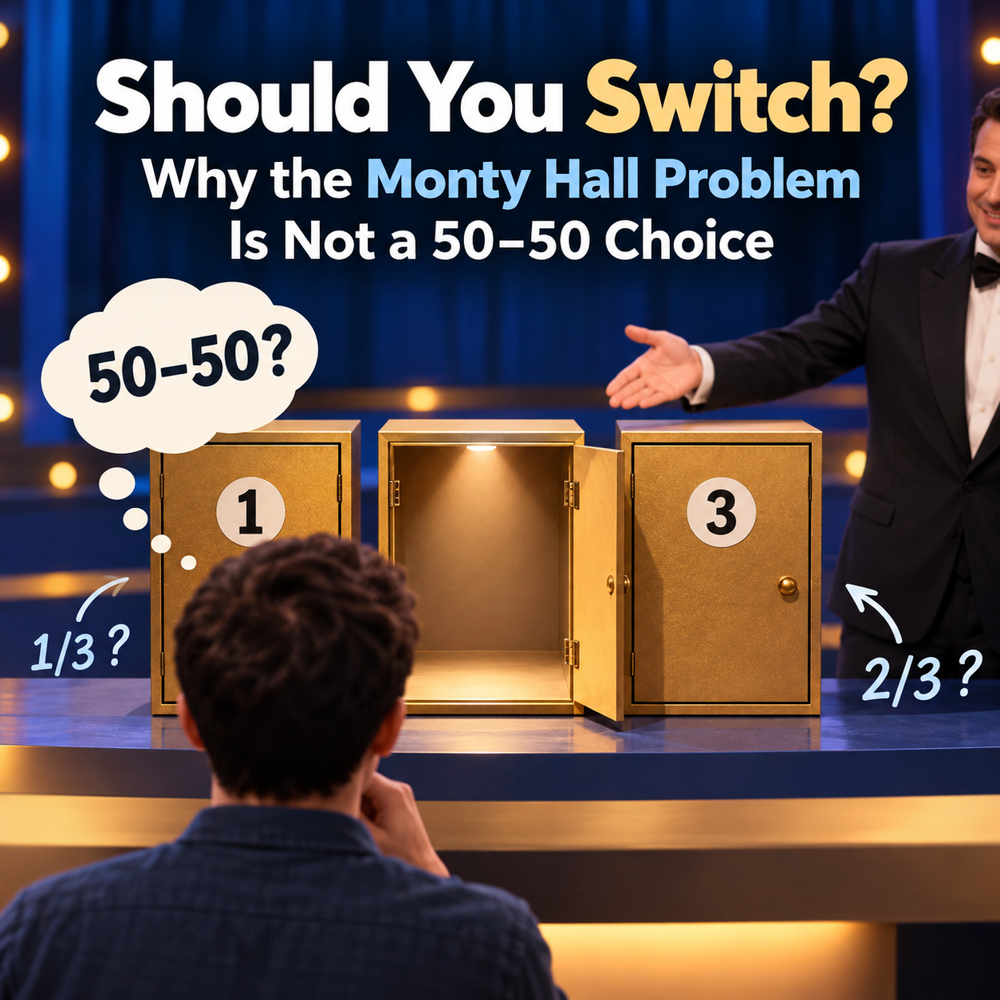

{width="500px"}

# Should You Switch? Why the Monty Hall Problem Is Not a 50–50 Choice

## Do Two Remaining Options Mean Equal Odds?

When a decision comes down to two options, it is tempting to assume that each has a $50\%$ chance of being correct. But that conclusion overlooks a crucial question: **How did those two options come to be the ones left?** If someone with relevant knowledge deliberately removed an option, the remaining possibilities need not be equally likely.

The Monty Hall Problem captures this distinction in a simple game. It is worth studying not just because the answer is surprising, but because it illustrates a broader principle of statistical reasoning: **to interpret information correctly, we must understand how it was generated.** Research findings, shortlists of job applicants, and news reports all involve selection processes. Ignoring those processes can distort how we interpret the evidence in front of us.

Our central questions are straightforward: Why is switching the better strategy in the standard game? And why does the host's removal of an empty box not reset the odds to $50$–$50$?

## The Setup: Rules That Make the Question Precise

Imagine three identical boxes, A, B, and C. One contains $\$10{,}000$ and the other two are empty. Each box is equally likely to contain the prize. You initially select A, without opening it.

The game follows four rules:

1. The host knows where the money is.
2. The host always opens an **empty box you did not choose**.
3. The host always offers you the option to keep your choice or switch to the other unopened box.
4. If two empty boxes are available, the host chooses between them at random, with equal probability.

Suppose the host opens B, revealing that it is empty. You can now stay with A or switch to C. **Which strategy has the higher chance of winning?**

These rules are central, not incidental. In particular, the host's knowledge and commitment to revealing an empty box determine what we can infer from his action.

## Clear Explanation: Why Switching Wins Two-Thirds of the Time

The simplest proof lists every possible location of the prize. Since A, B, and C are initially equally likely to contain the money, each row below has probability $1/3$.

| Prize location | Host opens | Stay with A | Switch |
|:---:|:---:|:---:|:---:|
| A | B or C | Win | Lose |
| B | C | Lose | Win |
| C | B | Lose | Win |

: All possible prize locations and their outcomes under each strategy. {#tbl-cases}

The pattern in @tbl-cases is decisive. Staying wins only when the initial choice was correct—one of the three cases. Switching wins whenever the initial choice was wrong—two of the three cases. Thus,

$$
P(\text{win by staying})=P(\text{initial choice correct})=\frac{1}{3},
$$

$$
P(\text{win by switching})=P(\text{initial choice incorrect})=\frac{2}{3}.
$$

**Switching works because the host's rule converts both kinds of initial mistakes into wins.** When your first box is wrong, the host has to open the other empty box, so the only unopened alternative is the winning one.

## Why Not 50–50? The Information-Revealing Process Matters

Before the host opens anything, A has a $1/3$ chance of containing the prize; B and C together account for $2/3$. The host does not eliminate an option independently of where the prize is. He knowingly reveals an empty box, so his action does not automatically increase the probability assigned to A to $1/2$.

We can also verify the result using conditional probability. Let $M$ denote the prize's location, and let $H_B$ denote the event that the host opens B. Under the stated rules,

$$
P(H_B\mid M=A)=\frac{1}{2},\qquad
P(H_B\mid M=B)=0,\qquad
P(H_B\mid M=C)=1.
$$

The case analysis above shows that switching wins in two out of three games. But after we actually see the host open B, we can ask a more precise question: **Given this particular reveal, how should we update the probabilities that A and C contain the prize?** This is where Bayes' rule becomes useful. It combines our beliefs about the prize's location before the reveal (the *prior probabilities*) with how likely the host would be to open B for each possible prize location (the *likelihoods*). The result is an updated probability after observing B (the *posterior probability*). Because the host deliberately avoids revealing the prize, opening B is not evidence produced by a random elimination process. Bayes' rule accounts for that selection mechanism and lets us verify why the two remaining boxes do not have equal chances. By Bayes' rule,

$$
\begin{aligned}
P(M=C\mid H_B)
&=\frac{P(H_B\mid M=C)P(M=C)}{P(H_B)}\\
&=\frac{1\times\frac13}{\frac12\times\frac13+1\times\frac13}\\
&=\frac{2}{3}.
\end{aligned}
$$

So even after learning specifically that the host opened B, C still has a $2/3$ chance of containing the prize.

**Change the rules, and the answer may change.** Suppose the host does not know where the money is and simply opens one of the two unchosen boxes at random. He might reveal the prize. If we restrict attention to cases where he *happens* to reveal an empty box, the two unopened boxes instead have equal conditional probabilities of $1/2$ each.

Both games may leave two unopened boxes, but they produce different probabilities. What matters is not merely how many options remain; it is **the process that removed the others**.

## Interpretation and Takeaway: What Does This Problem Teach Us?

The mathematical answer is unambiguous: **under the standard rules, staying wins with probability $1/3$, while switching wins with probability $2/3$. Switching is therefore the better strategy.** But the deeper lesson concerns how we reason about information.

First, **the number of options does not determine their probabilities**. Two alternatives are not automatically equally likely. Equal odds require a reason to regard the remaining alternatives as symmetric.

Second, **how information is selected matters as much as what it reveals**. Here, the host knows the answer and must remove an empty box. Outside the game, research samples, candidate shortlists, and reported facts may also be shaped by selection rules. We should ask what was excluded, by whom, and on what basis.

Third, **good decisions depend on evidence and assumptions, not just first impressions**. Switching is optimal in this particular game; it does not follow that changing your mind is always optimal in real life. The transferable skill is to identify the mechanism behind new information and revise judgments accordingly.

**The central takeaway is this: when options have been deliberately filtered, we cannot infer equal chances merely from the number that remain. To reason correctly about probability, we must understand how the information was produced.**