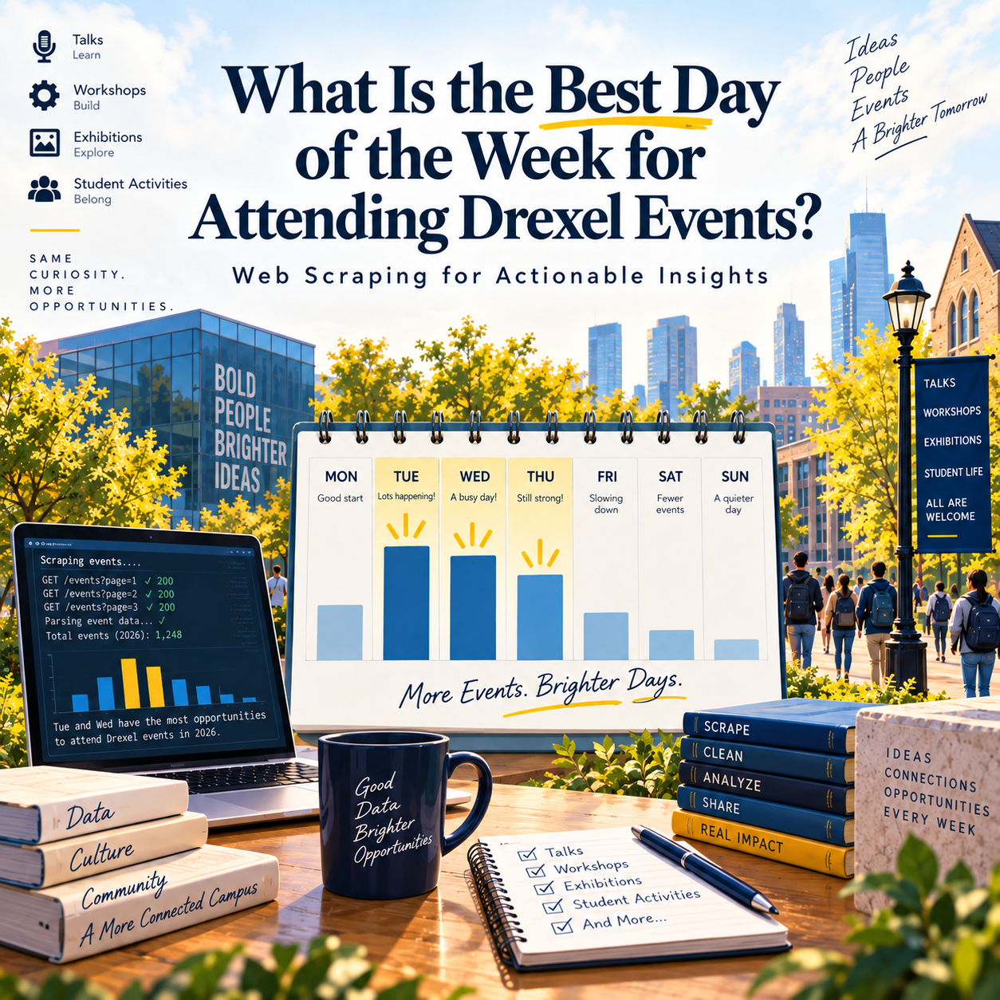
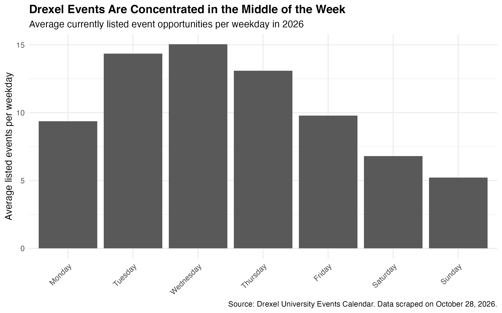
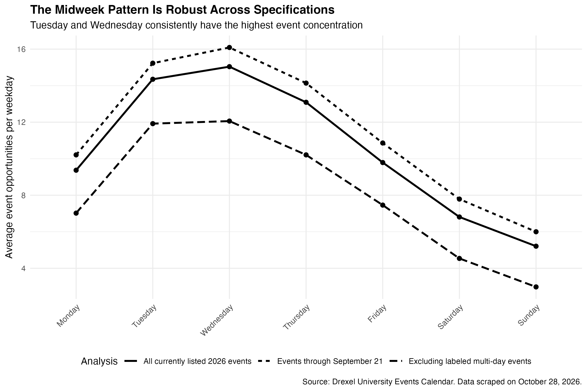

{width="500px"}

# What Is the Best Day for Drexel Events? Wednesday Leads, but Event Type Matters

## The scheduling problem

A university calendar may offer hundreds of activities, but students have only so much free time. If you could keep just one or two days relatively open for lectures, workshops, career activities, or cultural events, which days would give you the most choices?

I used the [Drexel University Events Calendar](https://calendar.drexel.edu/EventList.aspx) to answer a focused question: **Which day or days of the week offer the most opportunities among events currently listed for 2026?** Beyond identifying the busiest weekday, I also wanted to know whether different kinds of activities follow different weekly patterns.

## From calendar pages to attendance opportunities

Using R and `rvest`, I collected public event listings dated January 1 through December 31, 2026. I checked the site's robots rules before scraping, requested monthly calendar pages rather than individual event-detail pages, and paused for two seconds between monthly requests.

The scrape yielded **4,135 raw records**. The cleaning script removes listings explicitly marked as cancelled and exact duplicates identified by event ID, information ID, and date, leaving **3,843 cleaned event-date records**. This distinction matters: my unit of analysis is a **listed opportunity on a particular date**, not a unique event. An exhibition listed on several days can offer several possible visiting dates, so repeated dates are retained unless the records are exact duplicates. This measures opportunities *listed on the calendar*.

To compare weekdays fairly, I divided each weekday's cleaned event count by the number of times that weekday occurs in 2026. Thursday occurs 53 times; every other weekday occurs 52 times. The result is the **average number of listed opportunities per occurrence of that weekday**.

## Wednesday wins on volume—but Tuesday is close

{width=95%}

**Wednesday ranks first**, with **782 listings**, or **15.04 per Wednesday**. **Tuesday follows** with **746 listings**, or **14.35 per Tuesday**; **Thursday** is third with **694 listings**, or **13.09 per Thursday**. Together, these three midweek days account for **2,222 of 3,843 listings (57.8%)**.

The contrast with weekends is substantial. **Sunday averages 5.21 listings**, meaning a Wednesday has approximately **2.9 times** as many listed opportunities as a Sunday. Yet the difference between Wednesday and Tuesday is only **0.69 listings per weekday**. This is a descriptive ranking, not proof that Wednesday is always better for every student or in every week.

## What kinds of events are more common on different days?

A total event count does not tell someone whether those events match their interests. To explore this, I examined the `event_title` field in the cleaned dataset using case-insensitive keyword matches. These are **exploratory title-based indicators, not official event categories**; some titles may match more than one set of keywords, and repeated dates remain separate listings.

The differences are informative. Titles containing **“seminar,” “lecture,” or “colloquium”** appear **88 times**: **36 on Wednesdays** and **34 on Thursdays**, with none on weekends. Titles containing **“career,” “resume,” “networking,” or “interview”** appear **108 times**, including **45 on Tuesdays**—the largest count for any weekday in that group.

Weekends reveal a different mix. Titles mentioning **“exhibit,” “exhibition,” “gallery,” or “collection”** account for **85 of Sunday's 271 listings (31.4%)**, compared with **92 of Wednesday's 782 (11.8%)**. Meanwhile, titles containing **“performance,” “concert,” “recital,” “theatre,” “theater,” or “showcase”** appear **67 times** overall, including **23 on Saturdays**, more than on any other weekday.

These title patterns suggest a more useful interpretation than simply “midweek is best”: **Wednesday and Thursday are especially promising for academic talks; Tuesday stands out for career-related listings; and weekends can still be attractive for exhibitions and performances.** Because keyword searches are imperfect and long-running exhibitions generate repeated daily listings, these comparisons should guide further exploration rather than be treated as a definitive classification of all events.

## Does the midweek pattern survive closer scrutiny?

{width=95%}

Two potential distortions deserve attention. First, future events might not yet have been published when the data were collected. Second, long-running activities could inflate counts. I therefore compared the full sample with two alternatives.

Restricting the data to events **dated on or before October 28** gives **16.09 listings per Wednesday**, **15.23 per Tuesday**, and **14.14 per Thursday**. Excluding events **explicitly labeled “Multi-Day Event”** gives **12.06 per Wednesday**, **11.92 per Tuesday**, and **10.21 per Thursday**. **Wednesday remains first, Tuesday second, and Thursday third in all three versions.** The tiny Wednesday–Tuesday gap after removing labeled multi-day events also reinforces the practical value of keeping both days flexible.

The second check does not remove every recurring activity: a regularly repeated event may lack the “Multi-Day Event” label. The result is therefore evidence that the pattern is not driven solely by *explicitly labeled* multi-day listings, not a complete correction for all recurrence.

## What the snapshot cannot tell us

Calendar listings are time-sensitive. Although the dataset covers dates throughout 2026, **389 of the 3,843 cleaned listings are scheduled after the October 28 scrape date**. The cleaned monthly totals show **451 listings in April** but only **115 in December**. It would be premature to interpret the December figure as proof that fewer events actually take place then: some future activities may simply not have been posted yet.

The calendar also does not establish who is eligible to attend, whether an event is free, or whether listed events overlap in time. Nor does this descriptive analysis identify *why* organizers schedule certain types of events on certain days. These findings concern the **available listings in one snapshot**, not every event that ultimately occurred in 2026.

## A scheduling strategy, not just a ranking

If your goal is to discover the **largest overall selection**, start by keeping **Wednesday** relatively flexible, and add **Tuesday** if you can. If you are focused on **career preparation**, pay particular attention to Tuesday listings. For **seminars and academic talks**, check Wednesday and Thursday. If you have more free time on weekends, do not dismiss them: look specifically for **exhibitions on Sunday** and **performances on Saturday**, while confirming actual dates, hours, and admission rules.

The actionable lesson is that **the “best” day depends on the kind of opportunity you want**. Wednesday leads in overall volume, but a calendar becomes more useful when we connect the timing of events with the interests of the person planning to attend.
