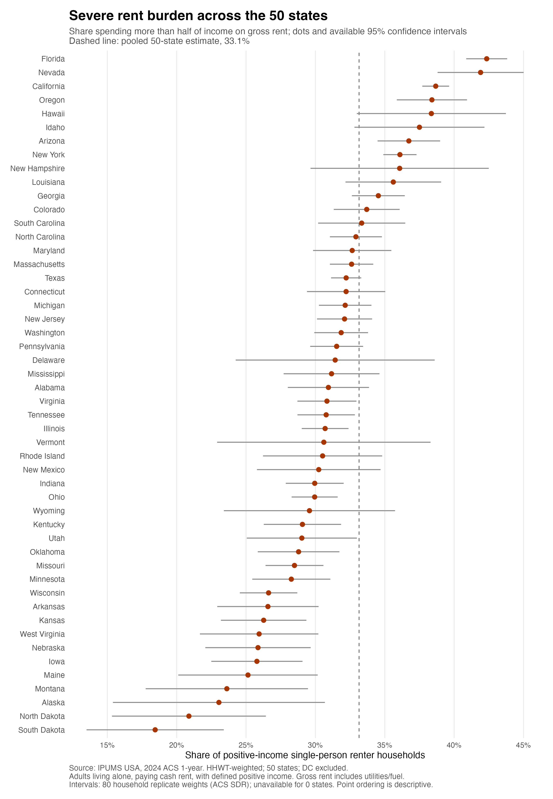
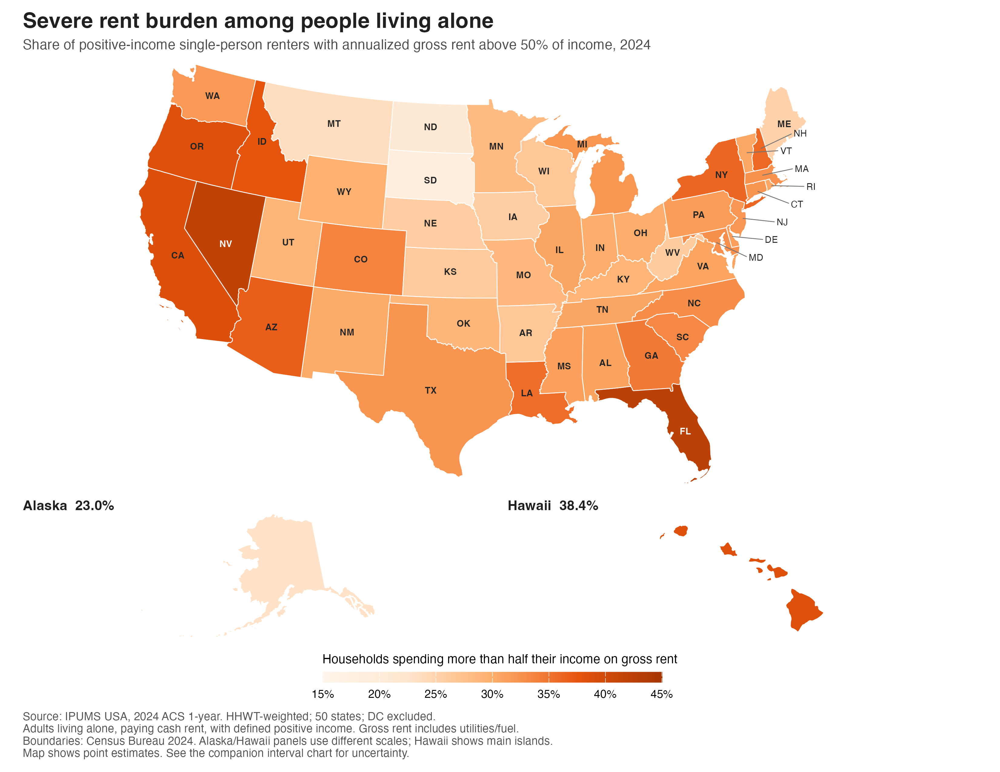
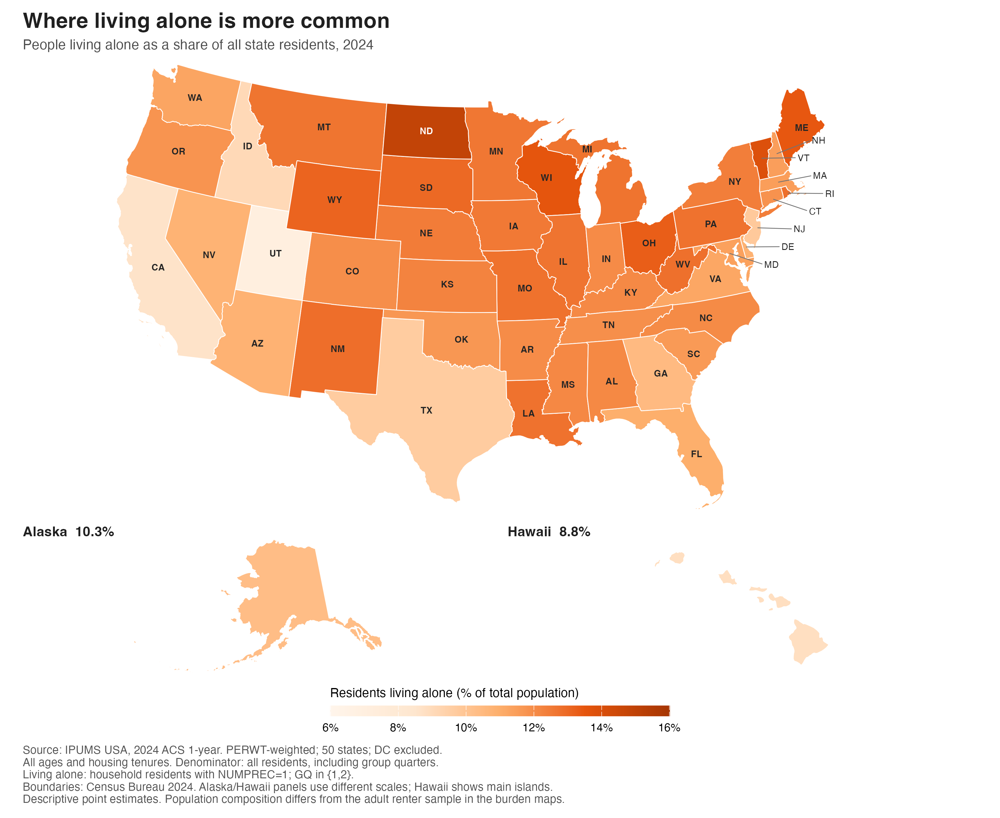

{width="500px"}

North Dakota and Florida tell two different stories about living alone. In 2024, 14.9 percent of North Dakota residents lived by themselves, compared with 11.0 percent in Florida. Yet among adult solo renters with positive income, 20.9 percent in North Dakota faced annualized gross rent above half their income. In Florida, the figure was 42.3 percent. Living alone was more common in North Dakota, but severe rent burden was roughly twice as common in Florida. Why do the two maps of independent living look so different?

The question matters when deciding whether a place fits your budget. Calculating rent as a percentage of your income is straightforward; understanding that number takes context. Is your housing budget unusually stretched, or do many solo renters nearby face similar pressure? State comparisons offer a broad benchmark, although they cannot tell you whether a particular apartment is overpriced. A high rent-to-income ratio can reflect expensive housing, limited income, or both. To explore that distinction, I used the 2024 American Community Survey through IPUMS USA, examining 135,366 adult one-person households that pay rent across the 50 states, with Washington, D.C., kept separate.

The first answer is that stretched budgets are widespread. Among solo renters with valid positive income, 60.6 percent had annualized gross rent above 30 percent of income, and 33.1 percent were above 50 percent—the severe-burden threshold used here. Figure 1 places those state estimates alongside the national benchmark. Florida and Nevada were both near 42 percent, while South Dakota was at 18.4 percent. For someone weighing the cost of living alone, that spread makes the national average an incomplete guide. The same housing arrangement can come with very different financial demands depending on where you live.

{width="95%"}

Still, Figure 1 is better read as a comparison than a league table. Its uncertainty bars show that each state's percentage is an estimate, with some measured less precisely than others. Small gaps between neighboring dots should not become confident claims about which state is more affordable. The chart also leaves out zero- and negative-income households because their rent-to-income ratios cannot be interpreted in the same way. It therefore captures pressure among positive-income renters, rather than the full extent of housing difficulty among everyone renting alone.

{width="95%"}

{width="95%"}

Figure 2 gives that pressure a location. Florida, Nevada and several western states stand out. Figure 3, showing where residents live alone, draws attention toward North Dakota and parts of the upper Midwest instead. California sharpens the contrast: just 8.6 percent of its residents lived alone, yet 38.7 percent of its positive-income adult solo renters faced severe burden. Across the 50 states, giving each state equal weight, the correlation between living-alone prevalence and severe burden was approximately −0.49. The pattern is a mismatch worth explaining, not evidence that increasing solo living would make housing cheaper.

Part of the explanation may lie in who appears on each map. A homeowner living alone counts toward Figure 3, but not toward the rental pressure in Figure 2. Figure 3 also covers all ages and compares solo residents with the entire state population. Figure 2 focuses on adult renters with positive income. A high living-alone share therefore does not necessarily mean a high share facing rental costs. Differences in age and homeownership could matter here, although this analysis does not measure their separate effects.

Looking at rent and income together makes the contrast more concrete. Florida's median annualized gross rent was $19,116, against $10,128 in North Dakota. Median annual income among renters with valid income was $37,000 in Florida and $40,000 in North Dakota. Florida's higher rent did not come with a higher median income. These medians summarize separate distributions; the burden calculations use each household's own rent and income, rather than dividing one statewide median by another.

Age adds another twist. Solo renters aged 65 and older paid less at the median: $12,000 in annualized gross rent, compared with $16,200 for those aged 18 to 64. Yet their severe-burden rate was higher, at 41.6 percent versus 29.8 percent. Their median annual income was also much lower: $22,800 versus $43,000. A smaller rent bill can still take a larger bite from a smaller income. That does not mean aging causes housing hardship, and income alone misses savings and assets that some older renters can draw on.

There are limits to the comparison. Gross rent includes utilities and fuel, and annualizes a current monthly amount; income refers to the previous 12 months before taxes. These are existing tenants' costs, not today's advertised rents. State-level figures also hide differences between cities and neighborhoods.

The useful next step is to bring the comparison closer to home. Compare apartments within the same local market, including utility costs. Calculate housing costs against dependable income and examine what remains for food, transport and unexpected expenses. If the budget looks tight, consider which adjustment would help most: a different neighborhood, a shared apartment, or a stronger income cushion. The maps provide context for that decision. A place where many people live alone may still demand more of your income than you can comfortably spare.

Data Source:
Steven Ruggles, Sarah Flood, Matthew Sobek, Daniel Backman, Grace Cooper, Julia A. Rivera Drew, Stephanie Richards, Renae Rodgers, Jonathan Schroeder, and Kari C.W. Williams. IPUMS USA: Version 16.0 [dataset]. Minneapolis, MN: IPUMS, 2025. https://doi.org/10.18128/D010.V16.0

Here is some additional detailed data; feel free to take a look if you are interested. Also, the analysis code is available in the
[GitHub Repository](https://github.com/RodgersYe/RodgersYe-Website).