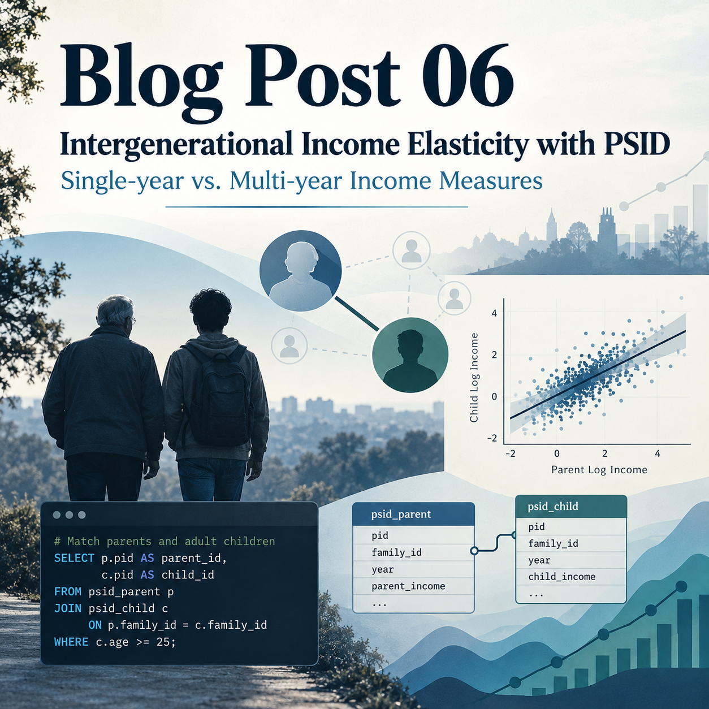
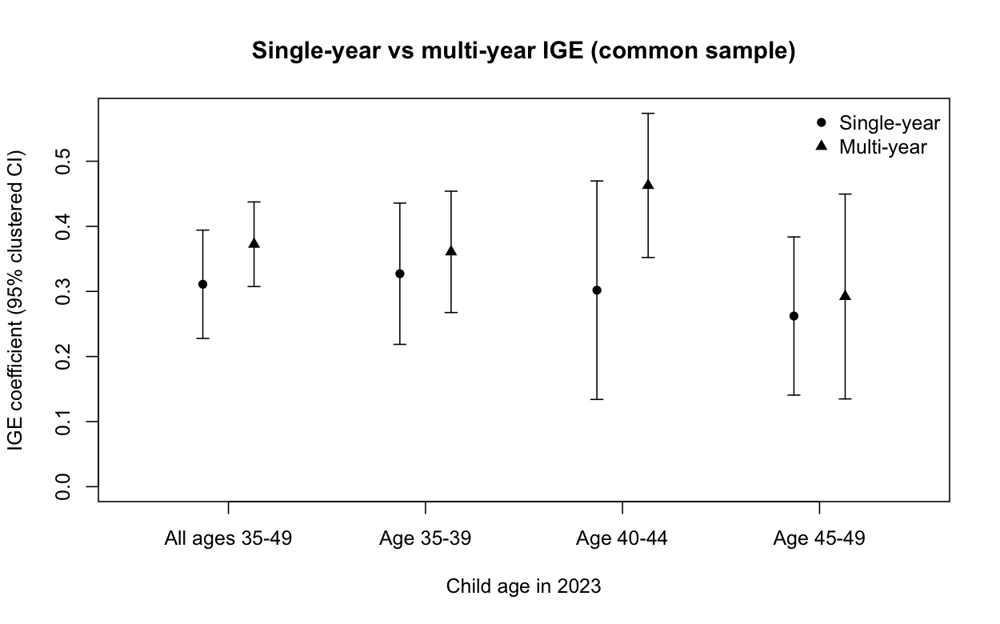

{width="500px"}

# Matching generations with SQL in Python and estimating intergenerational elasticity

Parents who earn more often have children who earn more as adults. **Does measuring earnings for one year rather than several change how strongly the two are related?** I use the **intergenerational elasticity of earnings (IGE)** to answer this question. The exercise also demonstrates how SQL, run inside Python, can turn separate longitudinal records into a matched parent–child dataset.

## 1. Match Parents and Children with SQL

I use the **Panel Study of Income Dynamics (PSID)**: its Parent Identification File links biological parents to children, its individual file tracks people across interviews, and its family files report earnings. Because a family ID can change when someone moves out, a family ID alone cannot identify a person over time. I first link each person's permanent 1968 family and person identifiers, then use interview-specific family IDs to attach earnings.

After importing and renaming the relevant PSID variables in pandas, I use Python's `sqlite3` to run SQL. This shortened excerpt shows the key matching step:

```python
import sqlite3
import pandas as pd

with sqlite3.connect(":memory:") as db:
    pid.to_sql("pid", db, index=False)
    ind.to_sql("individuals", db, index=False)
    matches = pd.read_sql_query("""
        SELECT p.child_fam68, p.child_pn,
               c.age23 AS child_age23, f.fam99 AS parent_family_1999
        FROM pid AS p
        JOIN individuals AS c
          ON p.child_fam68 = c.fam68 AND p.child_pn = c.pn
        JOIN individuals AS f
          ON p.father_fam68 = f.fam68 AND p.father_pn = f.pn
        JOIN individuals AS m
          ON p.mother_fam68 = m.fam68 AND p.mother_pn = m.pn
        WHERE f.fam99 = m.fam99 AND c.age23 BETWEEN 35 AND 49
    """, db)
```

`SELECT` chooses the columns to retain; each `JOIN` matches records using a two-part person key. The full script also checks parental roles in 1999 and the adult child's role in 2023, removes invalid IDs, and verifies that each child appears once. These checks matter: an incorrect join could pair the wrong people or duplicate observations.

## 2. Build Earnings Measures and Estimate IGE

Parental earnings combine both biological parents' labor and business labor earnings; children's earnings refer to the adult child's own labor and business labor earnings. The **single-year** measure uses parental earnings in **1998** and child earnings in **2022** (reported in the 1999 and 2023 interviews). The **multi-year** measure averages available parental earnings from **1998–2010** and child earnings from **2012–2022**, first converting each year's amount to **2022 dollars** using the BLS CPI-U. I require at least three valid parental years and three valid child years for the multi-year estimates.

SQL also makes this aggregation reproducible. After combining both parents' earnings within each eligible year, the following pattern produces their inflation-adjusted average:

```sql
SELECT p.child_fam68, p.child_pn,
       COUNT(*) AS n_parent_years,
       AVG(p.annual_parent_income * 292.655 / c.cpi)
           AS parent_avg_2022usd
FROM parent_income AS p
JOIN cpi AS c ON c.income_year = p.survey_year - 1
GROUP BY p.child_fam68, p.child_pn;
```

`GROUP BY` creates one record per child; `COUNT` counts eligible years and `AVG` averages real parental earnings. The full pipeline also uses `SUM` to combine parents' earnings and repeats the averaging for children. I retain positive values for the two measures used in each regression and estimate:

$$\log(\text{Child earnings})=\alpha+\beta\log(\text{Parent earnings})+\varepsilon.$$

Here, \(\beta\) is the IGE: an estimate of **0.30** means that 10% higher parental earnings are associated with approximately 3% higher adult-child earnings, not that parental earnings *cause* the increase. Regressions use R's `lm()` and 95% confidence intervals with standard errors clustered by parental family to account for siblings.

## 3. What Changes When We Average Earnings?

To ensure a fair comparison, both models use the **same 1,057 adult children** from **728 parental families**, aged **35–49 in 2023**.

{width="95%"}

*Note: Points show IGE estimates; error bars show 95% confidence intervals clustered by parental family.*

The overall single-year IGE is **0.311**, compared with **0.372** using multi-year averages. The higher multi-year estimate suggests that one-year earnings can obscure the persistent parent–child relationship through temporary earnings fluctuations.

The age breakdown illustrates why measurement timing deserves attention. For ages **40–44**, the multi-year estimate is **0.463**, versus **0.302** for a single year. Yet the difference is smaller at ages **35–39** and **45–49**, and uncertainty is substantial. Earnings at one age may poorly represent lifetime economic standing—often called **life-cycle bias**.

## Takeaway

In this matched PSID sample, multi-year earnings produce a higher IGE point estimate, consistent with a clearer measure of long-run earnings. The practical lesson is to match people carefully with SQL, average inflation-adjusted earnings when possible, and treat a single year's IGE as a potentially noisy snapshot—not a complete measure of economic mobility.

### Code Reference and Reproducibility

The two code examples above are simplified excerpts from the original analysis scripts. The first example, which demonstrates parent–child matching using `SELECT` and `JOIN` in Python's SQLite environment, is adapted from `03_multiyear_prepare_data.R`, lines **175–203**. Specifically, lines 175–196 define the SQL matching query, while lines 197–203 show how it is executed through Python's `sqlite3` and pandas. The second example, illustrating `GROUP BY`, `COUNT`, and `AVG` for constructing inflation-adjusted parental earnings, comes from the same file, lines **288–302**, particularly the `parent_avg` operation in lines 294–302. For the single-year parental earnings aggregation using `SUM`, see `01_singleyear_prepare_data(1).R`, lines **182–199**. These excerpts omit some data-cleaning steps and sample restrictions for readability. Readers can consult the complete scripts for the full matching procedures, income construction, and reproducible IGE estimates.

### Data Availability and Replication

All data used in this analysis are available from the PSID official download page](https://simba.isr.umich.edu/Zips/ZipMain.aspx). Researchers can register for a free account and download the **Family Files for every other year from 1999 through 2023** (1999, 2001, ..., 2023), along with the **Cross-year Individual File (1968–2023)** and **Parent Identification File (2023)**. 