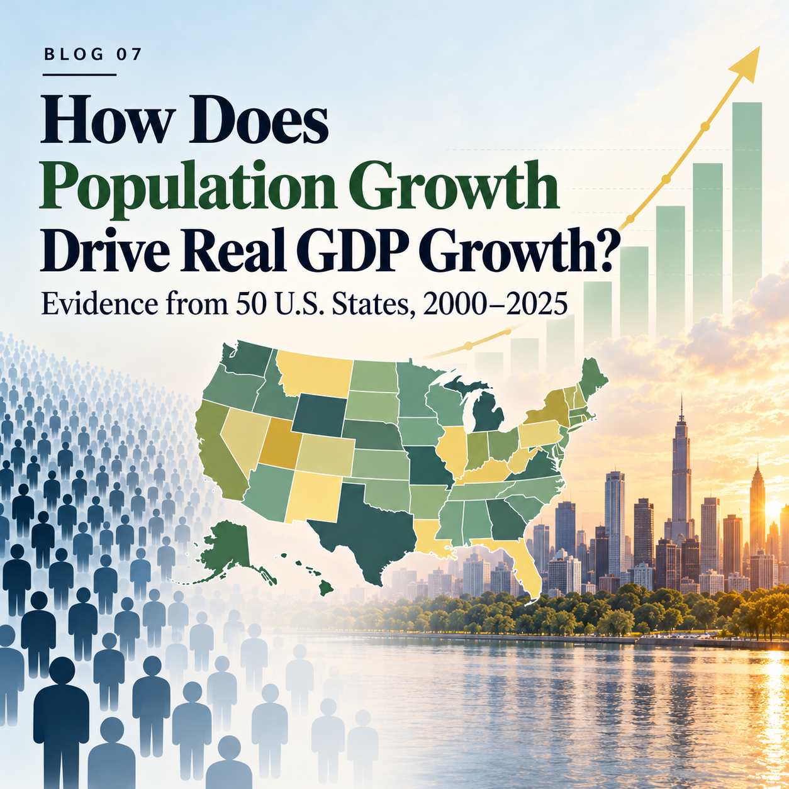

{width="500px"}

## Why Does Population Matter?

More residents can expand a state's labor force, customer base, and opportunities for specialization. In that sense, population growth can *support* economic growth. But does a faster-growing population always translate into faster-growing real output? **This post examines how population and real GDP move together across all 50 U.S. states, and why the answer changes over time.**

## Data and an Economic Accounting Framework

I use annual state population estimates from the **U.S. Census Bureau** and inflation-adjusted state GDP from the **Bureau of Economic Analysis (BEA)**, accessed through [FRED](https://fred.stlouisfed.org/). The dataset includes 50 states from **2000 to 2025**. Because a growth rate requires the previous year's value, annual growth comparisons begin in **2001**. Real GDP is measured in chained 2017 dollars.

The key accounting relationship is:

$$
\text{Real GDP} = \text{Population}\times\text{Real GDP per capita}.
$$

For annual percentage growth rates, this implies the useful approximation

$$
g_{GDP}\approx g_{Population}+g_{GDP\ per\ capita}.
$$

## Figure 1: How Much of GDP Growth Is Comparable to Population Growth?

The first interactive chart reports **population growth rate divided by real GDP growth rate, multiplied by 100**. Drag the year slider to compare states, hover for the underlying growth rates, and switch between *Focus* and *Full range* to inspect extreme observations.

<iframe class="interactive-frame" src="figures/figure_01_population_share_by_state.html" title="Interactive population share of real GDP growth by state, 2001 to 2025" loading="lazy" height="840"></iframe>

<strong>Figure 1.</strong> Population growth as a percentage of real GDP growth, 2001–2025. This is a ratio of growth rates, not a causal contribution. Values can be negative or exceed 100%, particularly when GDP growth is near zero.

Consider **Texas**: in **2023**, its population grew **2.00%** while real GDP rose **9.18%**, giving a ratio of **21.7%**. By **2025**, population growth had slowed to **1.25%** and GDP growth to **2.85%**; the ratio increased to **43.9%**. Thus, a larger ratio does not necessarily mean faster population growth. It can also reflect a slower-growing GDP denominator.

States can take sharply different paths in the same year. In **2025**, **North Carolina** recorded **1.32%** population growth and **1.83%** real GDP growth (a **72.3%** ratio). **New York** recorded approximately **0.01%** population growth but **2.48%** GDP growth (a **0.2%** ratio). The latter pattern points to the importance of real output per resident, not merely additional residents.

## Figure 2: Bigger Population, Bigger Economy?

The second chart shifts from *growth rates* to *levels*. Each dot represents a state: its population is on the horizontal axis and its real GDP on the vertical axis. Use the animation to see how the distribution and the fitted line change from **2000 to 2025**; hover to identify specific states.

<iframe class="interactive-frame" src="figures/figure_02_population_vs_real_gdp_2000_2025.html" title="Interactive state population versus real GDP levels, 2000 to 2025" loading="lazy" height="750"></iframe>

<strong>Figure 2.</strong> Annual state population (millions) versus real GDP (billions of chained 2017 dollars), with a fitted cross-state line. The relationship concerns economic <em>size</em>, not the causal effect of population growth.

Larger states generally produce more, but population alone cannot explain the variation. In **2025**, **Florida** had approximately **23.46 million** residents and **$1.38 trillion** in real GDP, while **New York** had fewer residents (**20.00 million**) but a larger economy (**$1.89 trillion**). Differences in output per resident, industrial structure, and employment patterns matter alongside population size.

## What Should We Take Away?

**Population growth is one route to a larger economy, not a guarantee of faster GDP growth or improved prosperity.** The changing ratios in Figure 1 highlight differences between population expansion and real output growth; Figure 2 shows why economic size alone cannot settle the question. Neither chart identifies a causal effect, and GDP per capita is not the same as household income or labor productivity.
