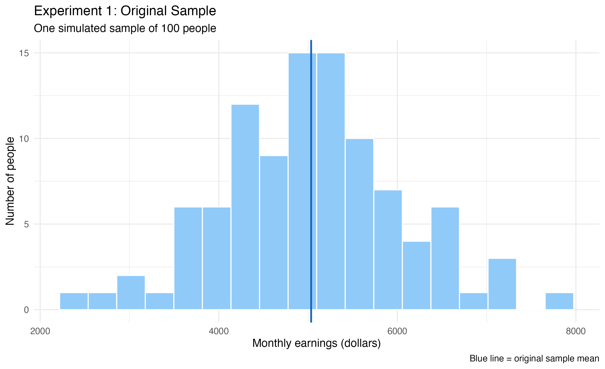
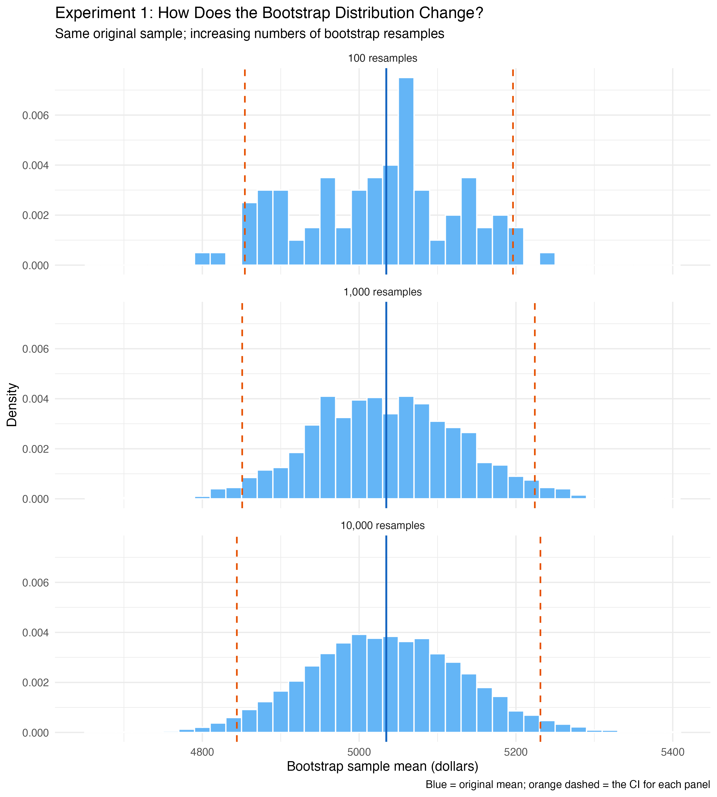
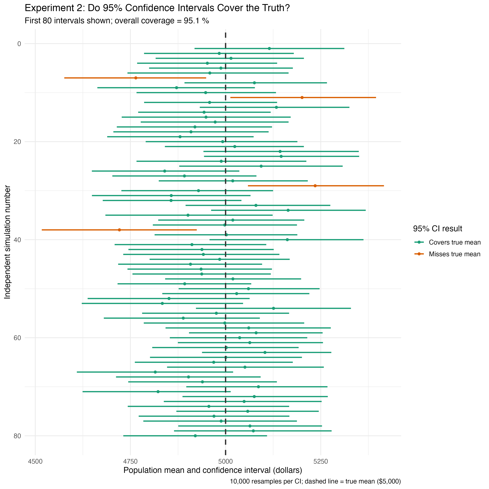
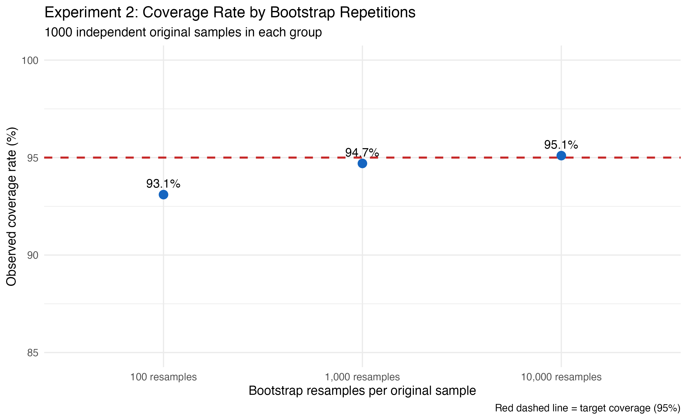
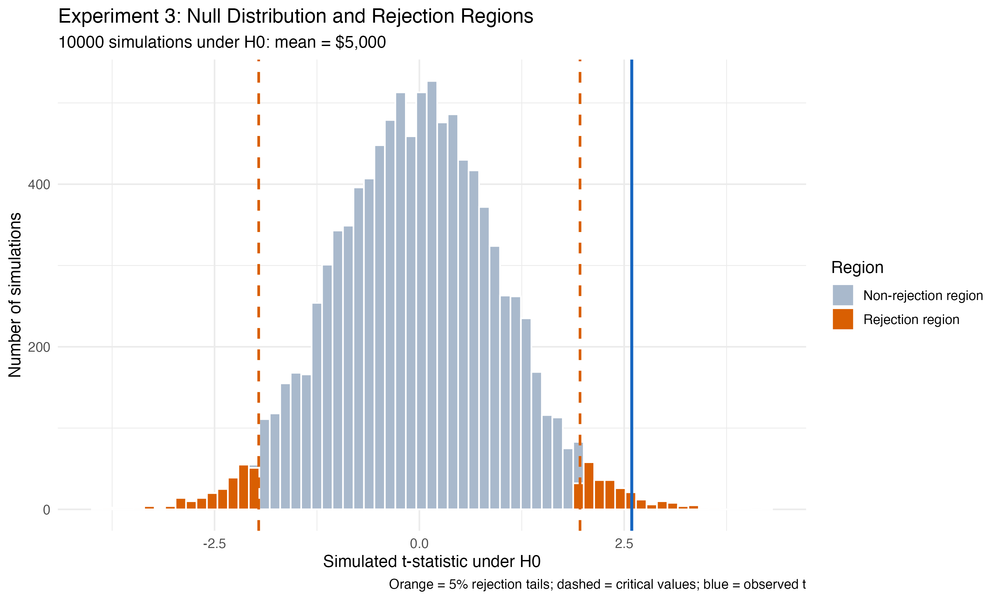
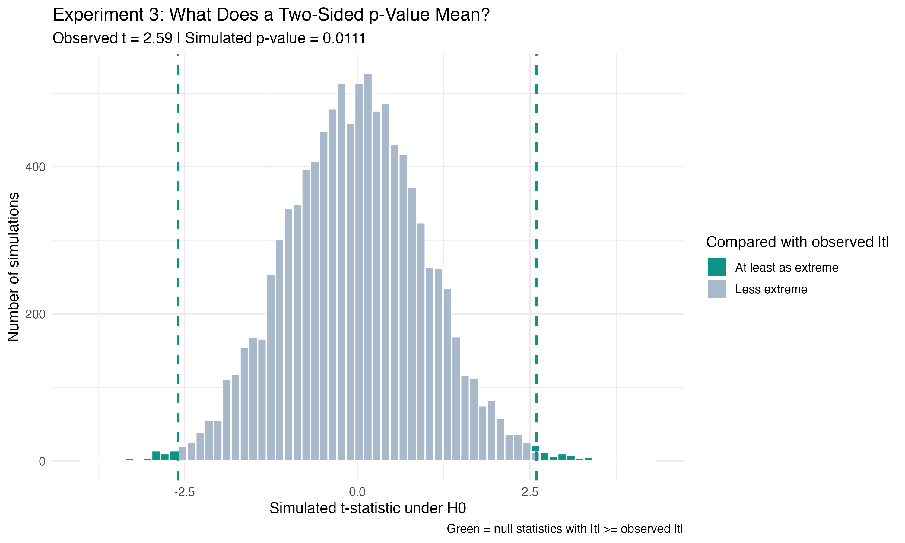

# A Simulation Guide to Confidence Intervals and p-Values

Suppose a survey of 100 people reports average monthly earnings of about \$5,035. Is that close to the population average, or simply a lucky draw? We rarely observe an entire population, so statistical inference must tell us how much uncertainty remains. I explored this question through three connected simulations: building an interval from one sample, checking how often such intervals succeed, and testing a hypothesis against a simulated world in which it is true.

## Experiment 1: Making uncertainty visible with the bootstrap

I generated 100 synthetic monthly earnings from a normal population with mean \$5,000 and standard deviation \$1,000. The sample mean was **\$5,034.63**, but another random sample would produce a different estimate.

The **bootstrap** approximates that sampling uncertainty without collecting new observations. I repeatedly drew 100 values **with replacement from the same original sample**, calculated each resample's mean, and plotted 10,000 such means. The resulting distribution is centered near the observed sample mean, not automatically at the true population mean.

{width="95%"}

{width="95%"}

I also compared 100, 1,000, and 10,000 bootstrap resamples. Their intervals were [\$4,854.25, \$5,196.24], [\$4,850.85, \$5,224.09], and [\$4,844.01, \$5,231.21]. The changing endpoints show **Monte Carlo variability**: more resamples make the percentile estimates steadier, but do not create new information about the population or guarantee a narrower interval.

## Experiment 2: Does “95% confidence” work 95% of the time?

One interval containing \$5,000 proves little. To evaluate the procedure, I generated **1,000 new, independent samples** of 100 people from the same population. For each sample, I constructed a 95% percentile bootstrap interval, repeating the calculation with three bootstrap counts.

{width="95%"}

{width="95%"}

The average interval width also increased from **\$373.53** with 100 resamples to **\$390.06** with 10,000; in this run, noisier percentile tails tended to produce shorter, less reliable intervals.

This is the meaning of **95% confidence**: if we repeated the entire sampling-and-interval procedure many times, roughly 95% of the resulting intervals would capture the fixed population mean. It does **not** mean the particular interval has a 95% probability of containing \$5,000 after it has been calculated.

## Experiment 3: What would be surprising if the null were true?

Now suppose we test **H₀: population mean = \$5,000** against a two-sided alternative. I generated 10,000 independent samples under H₀ and computed a t-statistic for each: **t = (sample mean − 5,000) / (sample standard deviation / √100)**.

{width="95%"}

For a separate simulated study, I deliberately generated observations from a population with mean \$5,200, although the hypothesis test treats that mean as unknown. This study yielded a sample mean of **\$5,233.35** and **t = 2.593**. Of the 10,000 null simulations, just **110** had |t| at least that large. With the standard plus-one simulation correction, the two-sided **p-value is (110 + 1)/(10,000 + 1) = 0.0111**.

{width="95%"}

Because **0.0111 < 0.05**, I reject H₀ at the 5% significance level. This means the observed result would be unusual *if H₀ were true*—**not** that H₀ has only a 1.11% probability of being true. At a stricter 1% level, the same p-value would not trigger rejection.

## What the three experiments teach us

Bootstrap distributions describe how an estimate might vary; repeated simulations reveal the **long-run reliability** of confidence intervals; and null simulations show how unusual an observed test statistic is under a stated hypothesis. All earnings here are **synthetic**, generated in R with fixed random seeds rather than drawn from a real earnings dataset. The normal model makes the logic easy to see; small, skewed, or otherwise different populations may produce less reliable percentile intervals.

**The takeaway:** Confidence intervals and p-values are not measures of how certain we feel. They are consequences of carefully defined procedures, understood by imagining the samples and test statistics we *could have observed*.
