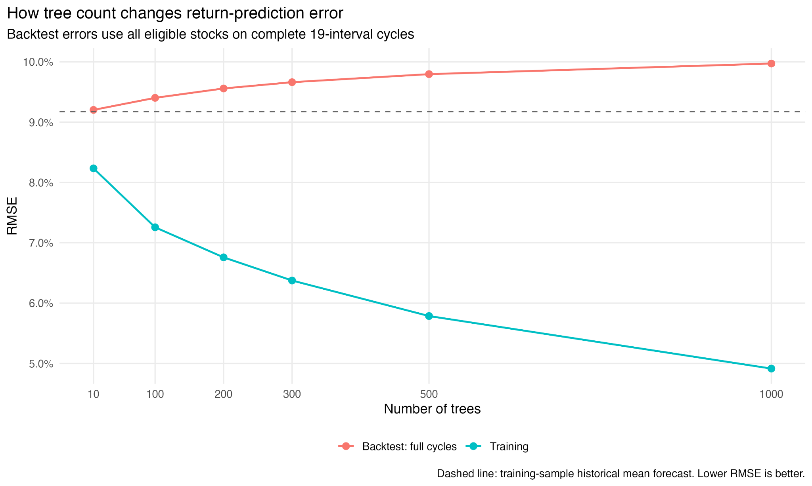
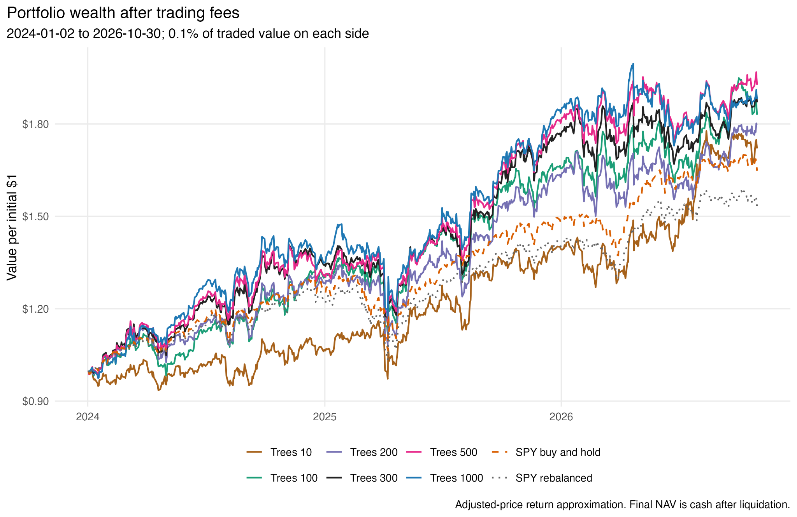
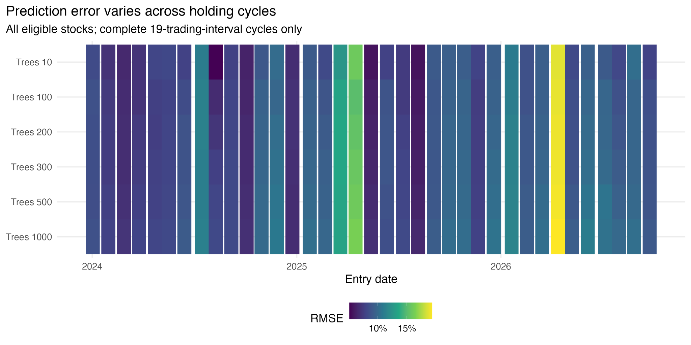

# Prediction accuracy and investment performance with XGBoost

## More accurate predictions, lower investment returns?

If you could choose only one model, would you choose the one with the lowest prediction error or the highest historical investment return?

In this stock-return experiment, an XGBoost model with ten trees delivered the most accurate predictions among the six models, yet earned the lowest portfolio return. A 500-tree model had greater prediction error but the highest cumulative net return, at 92.74%. After accounting for return volatility, however, its Sharpe ratio remained slightly below that of buying and holding SPY.

These results prompted me to revisit the classroom stock-prediction experiment. **Does changing the number of trees improve prediction or investment performance, and can it improve both?**

## From the classroom model to a single-parameter experiment

The classroom experiment used XGBoost to turn price, volume, momentum, volatility, and market-relative features into return forecasts, then selected highly ranked stocks for a portfolio. XGBoost adds decision trees sequentially to reduce training loss.

I used the classroom setting of 300 trees as the reference and compared it with 10, 100, 200, 500, and 1,000 trees. All six models used identical training data, 14 predictors, and other parameters. Changing only tree count allowed me to examine how model complexity affected the results.

Data came from Yahoo Finance through tidyquant, covering the 95 stocks in the fixed classroom universe and SPY over the requested January 2022–October 2026 window. After constructing features and screening the training boundary, the common sample contained 33,725 observations, with all training labels realized before 2024. Every model shared corrections to the original procedure's cross-boundary label leakage and weight normalization.

## Turning predictions into investments

Each model was fitted once and subsequently generated forecasts using information available at each signal day's close. The portfolio entered at the next trading day's close and exited at the twentieth trading day's close after the signal, spanning **19 trading-day intervals**. On each exit date, it bought the next portfolio using a new signal formed the preceding trading day.

Each cycle selected the ten highest return forecasts. Positive forecasts were normalized into portfolio weights, while nonpositive forecasts received zero weight. If all ten forecasts were nonpositive, the strategy used equal weights, although this fallback never occurred in the backtest. Adjusted closing prices approximated total returns, and every purchase and sale incurred a 0.1% fee.

Actual trading ran from January 2, 2024, through October 30, 2026. Forecast evaluation used **37 complete cycles × 95 stocks, or 3,515 observations**. The final cycle, containing only seven trading-day intervals, still entered investment returns and ended with full liquidation. Stocks share market shocks, so these observations are correlated.

## More trees fit better but predict worse

{width="95%"}

As tree count increased from ten to 1,000, training RMSE fell from 8.23% to 4.91%, while out-of-sample RMSE rose from 9.20% to 9.97%. The model fitted known observations increasingly well while becoming less accurate at forecasting subsequent returns. This divergence is consistent with overfitting.

| Model | RMSE | Direction accuracy | Mean rank correlation |
|---|---:|---:|---:|
| Historical mean | 9.18% | 56.36% | — |
| 10 trees | 9.20% | 55.59% | 0.0178 |
| 100 trees | 9.40% | 52.72% | 0.0189 |
| 200 trees | 9.56% | 51.66% | 0.0211 |
| 300 trees | 9.66% | 52.75% | 0.0172 |
| 500 trees | 9.80% | 52.63% | 0.0227 |
| 1,000 trees | 9.97% | 52.52% | 0.0218 |

: Out-of-sample predictive performance. {#tbl-prediction}

RMSE measures numerical return-prediction error, with lower values indicating better accuracy. Direction accuracy measures whether predicted and realized returns are both positive or both nonpositive. Mean rank correlation averages the within-cycle Spearman correlations between predicted and realized returns.

Reducing the classroom model to ten trees improved out-of-sample RMSE by approximately **0.46 percentage points**. For numerical prediction, reducing complexity was an effective improvement attempt.

However, the simplest historical-mean benchmark retained a slight advantage. It forecast approximately 1.34% for every stock in every cycle and achieved an RMSE of 9.18%, approximately 0.03 percentage points below the ten-tree model. This small difference has not been tested for significance. Because the benchmark always predicted a positive return, its 56.36% direction accuracy equaled the share of positive realized returns in the test sample. Direction accuracy above 50% therefore need not indicate that a model provides more information than a simple rule.

## The most accurate model earned the lowest portfolio return

{width="95%"}

Investment returns did not change monotonically with tree count. Ten trees produced the lowest model prediction error and the lowest model portfolio return, at 72.02%. Five hundred trees had higher RMSE than the classroom reference but earned a cumulative net return of 92.74%, approximately **5.7 percentage points** more.

The evaluation criteria emphasize different outcomes. RMSE measures numerical errors across all 95 stocks, while portfolio returns depend on the smaller set receiving capital and their weights. Reducing errors for many unselected stocks can improve RMSE without improving the actual investment. Forecast changes also affect capital allocation among selected stocks, further influencing portfolio returns.

Although 500 trees had the highest mean rank correlation, its value of 0.0227 was still close to zero. That statistic is insufficient to establish that the highest return came from a stable stock-selection advantage. Individual stock outcomes, weights, and market paths could all affect the results.

Cycle-level performance further qualifies the interpretation that 500 trees performed better. It exceeded the 300-tree strategy in only **18 of 38 cycles**. Their selected lists overlapped by **8.68 stocks** on average, yet their final wealth differed. The cumulative advantage depended on the magnitudes of cycle gains and losses and their compounding, and could also reflect a few selection changes and different weights.

## Did higher returns justify the additional risk?

| Strategy | Cumulative net return | Annualized volatility | Maximum drawdown | Sharpe ratio |
|---|---:|---:|---:|---:|
| 10 trees | 72.02% | 21.99% | 16.24% | 0.98 |
| 100 trees | 82.98% | 22.01% | 18.04% | 1.08 |
| 200 trees | 79.74% | 21.64% | 19.31% | 1.07 |
| 300 trees | 87.02% | 21.35% | 18.35% | 1.15 |
| 500 trees | 92.74% | 21.01% | 17.55% | 1.21 |
| 1,000 trees | 88.13% | 20.72% | 20.70% | 1.18 |
| SPY buy-and-hold | 64.79% | 15.44% | 18.76% | 1.22 |
| SPY rebalanced | 53.04% | 15.46% | 19.08% | 1.05 |

: Returns and risk after transaction fees. {#tbl-investment}

Maximum drawdown is the largest decline from a previous wealth peak, reported as a positive loss magnitude. Sharpe ratios use daily returns after fees and assume a zero risk-free rate.

The Sharpe ratio measures excess return per unit of return volatility. It helps assess whether higher returns compensate for additional risk and allows comparisons of risk-adjusted performance across strategies. Under this study's zero-risk-free-rate assumption, the annualized calculation is mean daily net return divided by its standard deviation, multiplied by √252.

Compared with 300 trees, 500 trees delivered higher returns, lower volatility and maximum drawdown, and a higher Sharpe ratio, rising from 1.15 to 1.21. Its improvement relative to the classroom reference therefore appeared across several investment measures.

The comparison with SPY buy-and-hold was different. The 500-tree strategy's annualized volatility was 21.01%, substantially above SPY's 15.44%. Although it earned more, its Sharpe ratio was slightly lower, at 1.21 versus 1.22. This small difference has not been tested for statistical significance, and using an observed risk-free-rate series could change the result. The evidence supports higher historical cumulative returns, while providing insufficient grounds to conclude that risk-adjusted performance was superior.

Increasing tree count to 1,000 did not continue to improve overall investment performance. Cumulative net return was lower than with 500 trees, while maximum drawdown widened to 20.70%. Additional model complexity produced no consistent improvement in the risk–return trade-off.

Trading costs were also economically meaningful. Repeatedly liquidating and repurchasing SPY reduced its net return from 64.79% to 53.04%. All six models completed the same 38 round trips, so the common proportional fee rule reduced their terminal wealth without changing their terminal ranking.

## When did all models struggle to predict returns?

{width="95%"}

In that high-error cycle, RMSE ranged from 18.68% to 19.33% across all six models. Colors were usually similar across models within a given period, suggesting that shared prediction difficulties often outweighed the differences associated with tree count.

Errors were generally higher later in the backtest, but fluctuated substantially. Changing predictive relationships and more extreme realized stock returns could both increase RMSE. Because this experiment did not compare fixed models with periodically retrained models, it cannot isolate the effect of aging training data.

## What did this experiment change?

**Fewer trees improved prediction error, 500 trees improved historical investment performance relative to the classroom reference, and SPY retained a slight advantage in the observed Sharpe comparison.** The preferred model therefore depends on the evaluation objective. More accurate return estimates, higher cumulative returns, and better risk-adjusted performance each require evaluation.

Five hundred trees was identified as the historical return winner after observing the complete backtest. Its advantage has yet to be validated in a new independent period. The fixed stock list may introduce survivorship bias, adjusted prices may be revised retrospectively, and simulated execution omits slippage and market impact.

This experiment demonstrates that **better training fit cannot substitute for out-of-sample evaluation, and better out-of-sample prediction error cannot substitute for investment evaluation.** Assessing a stock-prediction model requires following the full sequence from forecasts to selection, capital allocation, trading costs, and risk. The value of changing tree count should ultimately be judged against those combined outcomes.
